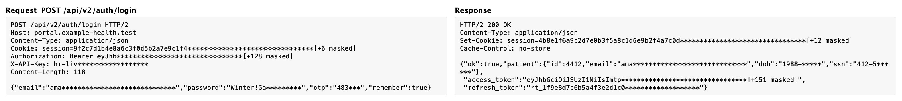
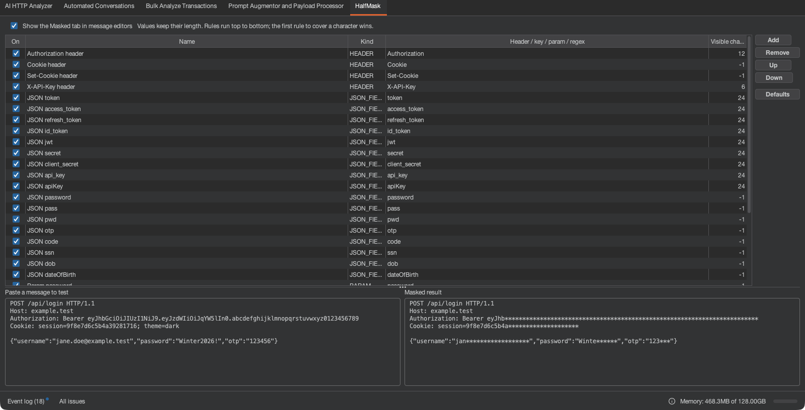

# HalfMask for Burp Suite

Show half the secret. Keep the layout.

HalfMask masks passwords, cookies, tokens and personal data in Burp Suite message editors so a report screenshot proves the finding without leaking the value. Each value keeps its first characters and its full length. The real traffic, the history and the project file never change.

Page: https://sec.the-radar.net/tools/halfmask



## What it does

- Adds a read-only **Masked** tab next to Pretty / Raw / Hex in every request and response editor (Proxy history, Repeater, Logger, Intruder results).
- Masks by rule. Short values keep half; long credentials such as a JWT keep a fixed 24 characters; one or two character values are masked in full. Length is preserved, so a reader can match the same token across two figures and the masked capture lines up with the real one.
- Right-click any message: **HalfMask: export masked PNG** writes the masked request and response side by side as a PNG figure at print resolution. Select several rows to export one PNG per message. **Copy masked request / response** puts the masked text on the clipboard.
- A **HalfMask** suite tab holds the rule table (header, cookie, JSON field, parameter, regular expression), the visible-prefix length per rule, a paste-to-test box, and the on/off switch. Rules persist in Burp's user settings.



## Default rules

| Matches | Kind | Visible |
| --- | --- | --- |
| Authorization header | header | first 12 characters |
| Cookie, Set-Cookie | header | first half |
| X-API-Key | header | first 6 characters |
| token, access_token, refresh_token, id_token, jwt, secret, client_secret, api_key, apiKey | JSON field | first 24 characters |
| password, pass, pwd, otp, code, ssn, dob, dateOfBirth | JSON field | first half |
| password, token, access_token, api_key, code | parameter | first half |
| any JWT or JWE anywhere in the message | pattern | first 24 characters |
| email address | pattern | first 3 characters |
| US phone number, patientName | pattern, JSON field | included, off by default |

Rules run top to bottom. The first rule to cover a character wins. Add your own: a header, cookie name, JSON key, parameter name, or a regular expression where group 1 is the value.

## Install

1. Download `halfmask-1.0.0.jar` from the [latest release](https://github.com/the-radar/burp-halfmask/releases/latest), or build it: `mvn package` writes `target/halfmask-1.0.0.jar`.
2. In Burp: Extensions, Installed, Add, type Java, pick the jar.
3. Open any request. The Masked tab is next to Pretty, Raw and Hex.

Needs Burp Suite Professional or Community 2023.10 or later (Montoya API). Java 17 or later to build.

## Safety

HalfMask sends no traffic, opens no network connection, runs no background threads, and writes nothing except the PNG files you ask for. Message content is treated as untrusted: every rule pattern is linear in the size of the message, so a multi-megabyte body does not freeze the editor. Unloading the extension releases everything it holds.

## Build and test

```
mvn package
```

The masking engine (`Masker`, `MaskRule`) is plain Java with unit tests under `src/test`.

## License

MIT. See [LICENSE](LICENSE).
